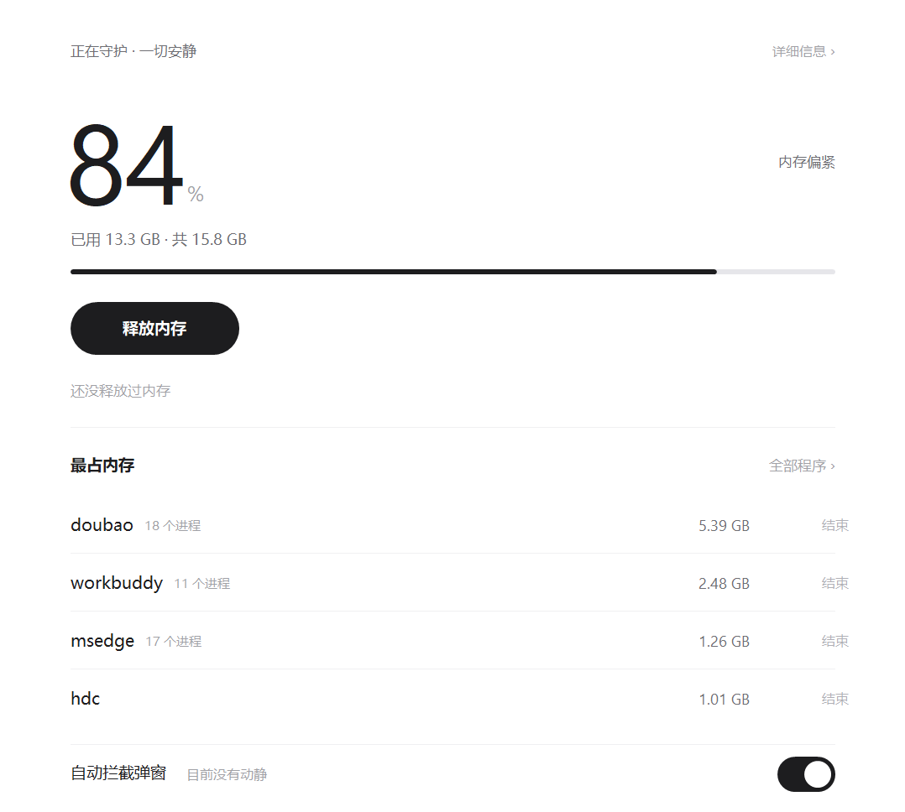
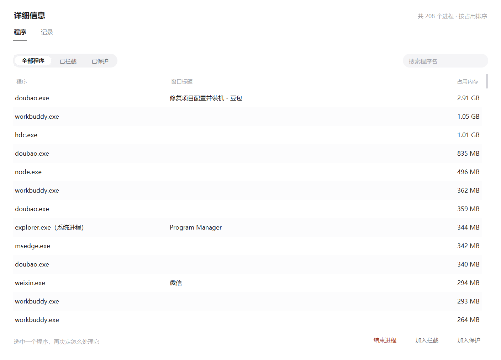

# Memory Guard

A single-file memory monitor for Windows. It shows physical memory usage, frees working sets on demand, and closes the popup / promo processes that some desktop apps spawn in the background.

Pure standard library: `ctypes` against Win32, `tkinter` for the UI. No `pip install`.



## What it does

- **Merges processes by program.** Eighteen `doubao.exe` become one row labelled "18 processes".
- **Frees memory without closing anything.** Moves background working sets to disk (`EmptyWorkingSet`). Run as administrator to also purge the standby list.
- **Auto-frees above a threshold** — 85% by default, 120 s cooldown.
- **Closes known promo processes**: ads, tips, updaters, background helpers. Main applications are never in the rule list.
- **Leaves running apps alone.** A program is skipped as a whole if any of its processes has a visible window.

## Requirements

Windows 10 or 11, Python 3.9+. Nothing else.

## Usage

```bat
python  memory_guard.py --version      :: print version
python  memory_guard.py --selftest     :: console self-check
pythonw memory_guard.py                :: start in background
python  make_icon.py                   :: generate icon.ico + PNG sizes
python  install_shortcut.py            :: create desktop shortcut
```

Clicking the shortcut twice does not open a second window; it brings the running one to the front.

## Details window



Two pages (Programs / Log) and three views (All / Blocked / Protected). Built-in protection rules can be disabled individually, and your own whitelist entries can be added.

## Files

| File | |
| --- | --- |
| `memory_guard.py` | everything, ~2500 lines |
| `make_icon.py` | generates the icon set with GDI+ |
| `install_shortcut.py` | desktop shortcut |
| `launch.vbs` | silent launcher, no console window |
| `使用说明.txt` | end-user guide (Chinese) |

## Limitations

- The rule set is 36 static regexes. If a program you use is missing, you have to add a rule yourself; nothing is detected automatically.
- Freeing memory only trims backing processes. Usage climbs back as programs touch their pages again. That is how Windows works, not a bug.
- Layout was tuned at 150% scaling. Other DPI settings may look off.
- No `.exe` build. Python is required.

## License

MIT. See [LICENSE](LICENSE).

---

[中文说明](README.zh-CN.md)
